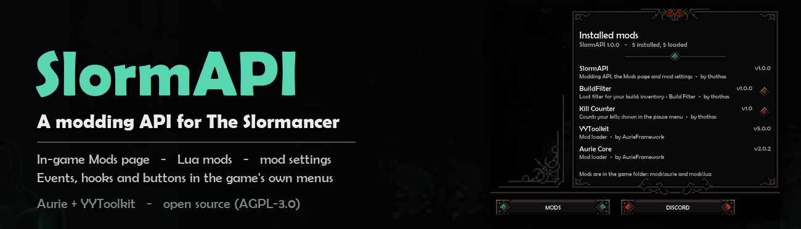
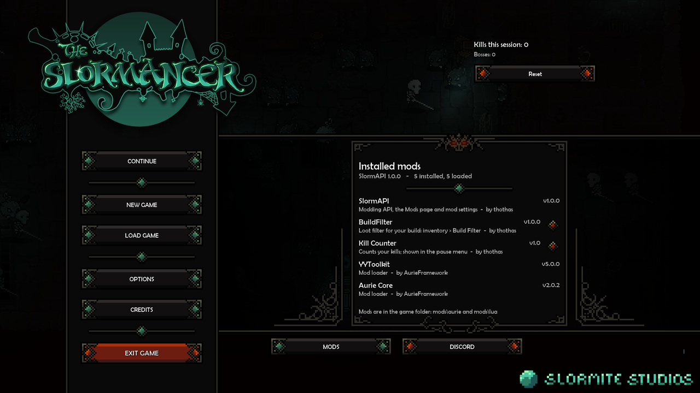
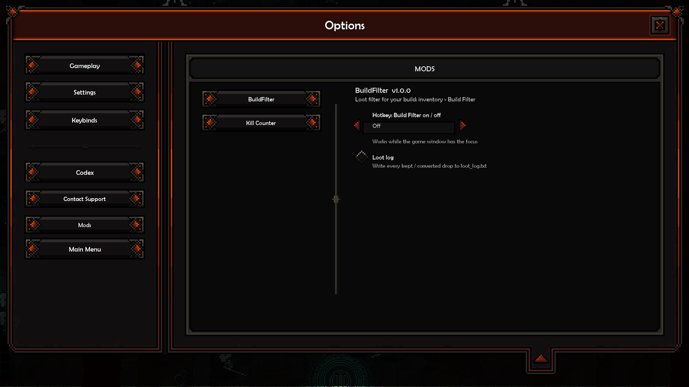

# SlormAPI 1.0.0 — a modding API for The Slormancer



SlormAPI lets other mods (and, optionally, development tools) read and change The Slormancer while it runs: game
variables, instances, scripts and built-in functions, script hooks, game events, and drawing with the game's own
sprites and fonts — including buttons in the game's own menus that hover, click and slide like native ones. Mods use
it from C++ or as **Lua mods**: one text file in `mods\lua`, loaded while the game runs.

On its own it adds two things to the game's menus:
- a **MODS** button next to DISCORD in the main menu and the pause menu. It lists the installed mods with their
  versions (5 per page) and switches mods on or off: a switched-off mod is renamed to `X.dll.disabled`, so it is not
  loaded from the next game start (Lua mods switch at once). SlormAPI and the loader cannot be switched off there,
  and mods installed with Vortex are switched in Vortex.
- a **Mods** tab in Options with the settings of every mod that has some, drawn like the game's own settings.





The Mods page also warns when something is wrong: a mod whose requirements are not met ("Needs SlormAPI 1.0.0"), a
Lua mod with an error, a mod whose game functions were not found after a game update, and a game that crashed last
time (the button then reads MODS (!)).

Example mods: `examples/lua/kill_counter.lua` here, and **[BuildFilter](https://github.com/tsotsas/BuildFilter)**, a
loot filter made twice - in C++ and in Lua - with the same features.

## Requirements
- The Slormancer (Windows, Steam version)
- The **Aurie** mod loader (Aurie Core 2.0.2 + YYToolkit 5.0.0): the installer below sets it up. A game that already
  loads Aurie mods another way works as it is.

## Install
Easiest: **`SlormAPI-Installer-1.0.0.zip`** from the [Releases](https://github.com/tsotsas/SlormAPI/releases). Unzip
it, close the game, double-click `Install.bat` and choose 1. It installs the Aurie loader (the official Aurie Core
2.0.2 + YYToolkit 5.0.0c, checked against their release checksums) and SlormAPI, and can repair the loader after a
game update or remove everything. When the game already loads Aurie through another mod loader (a `version.dll`
loader), it keeps that loader and adds only the mod.

Manually (`SlormAPI-1.0.0.zip`, the game-folder layout: `mods/Aurie/SlormAPI.dll`):
1. Have Aurie + YYToolkit for The Slormancer (https://github.com/AurieFramework/Aurie,
   https://github.com/AurieFramework/YYToolkit), or a game where Aurie mods already load.
2. Unzip it into `<The Slormancer folder>`.

Uninstall: delete `SlormAPI.dll` (or installer > 4). SlormAPI never writes your save files.

## For mod authors
**Full reference: [docs/API.md](docs/API.md)** — every command, event, draw program, widget and Lua function in
detail, the item format, a game cheat sheet, and how to start a C++ or Lua mod. The short version:

Copy `source/SlormAPI_Interface.hpp` into your Aurie module and get the interface (modules can load in any order, so ask
for it from a game callback, not in `ModuleInitialize`):

```cpp
#include "SlormAPI_Interface.hpp"
Aurie::AurieInterfaceBase* base = nullptr;
if (AurieSuccess(Aurie::ObGetInterface(SLORMAPI_INTERFACE_NAME, base)))
{
    auto* api = static_cast<SlormAPIInterface*>(base);
    const char* r = api->Request(R"({"cmd":"get","path":"current_hero"})");   // {"ok":true,"result":0}
}
```

Call `Request` on the game thread (from a YYToolkit callback). Every request is one JSON object with a `cmd`:

| cmd | fields | does |
|---|---|---|
| `ping` | | version, room, fps, `game_version`, `last_session` (did the last one crash) |
| `get` / `keys` | `path` ("a.b[3]"), `root` ("global", an object name, or `{"$inst": id}`), `depth` | read a value / list members |
| `set` | `path`, `value`, `root` | write a value (arrays are written in place) |
| `call` | `fn`, `args`, `self` | call a game script or built-in function |
| `instances` | `object`, `vars` | instances of an object (+ chosen variables) |
| `objects` / `scripts` | | asset lists |
| `hook` | `owner`, `script` or `scripts`, `capture`, `capture_args`, `depth`, `overrides`, `after`, `ttl_ms`, `post_set` | hook game scripts (below) |
| `unhook` | `owner`, `script` (none = all your hooks), `all` | remove your hooks |
| `hooks` / `hooklog` | – / `owner`, `max`, `consume` | list hooks (with each owner's layer) / read your captured calls |
| `register_mod` | `name`, `version`, `author`, `description`, `file`, `requires`, `game` | show your mod on the Mods page; `requires` e.g. `{"SlormAPI": "1.0.0"}`, `game` the game version it was made for |
| `mods` / `mods_page` | – / `enabled`, `open` | the installed mods / switch the Mods page off or open it |
| `mod_enable` | `file` ("X.dll"), `enabled` | switch a mod of `mods/aurie` on or off for the next start |
| `overlay` | `event`, `vars`, `when`, `calls`, `ttl_ms` | a draw program run after an object event (default the GUI draw) |
| `subscribe` / `unsubscribe` / `events` | `owner`, `events` / `owner`, `events` / `owner`, `max` | game events (below) |
| `event_types` | | the event names |
| `ui_add` / `ui_remove` / `ui_refresh` | `owner`, `menu`, `program` / `owner`, `menu` / – | your drawing and widgets in a game menu (below) |
| `item_info` | `item` (an item array) or `inst` (a dropped item) or `equipped` (0-10: helm .. cape) | the item in readable form: slot, level, rarity, legendary, every stat with its name and value, extras |
| `stat_info` / `legendary_info` / `skill_info` | `stat` (+ `slot`, `roll`, `level`) / `id` / `hero`, `id` | names and data from the game's own files; `stat_info` with a `roll` also gives its `value` on an item of `level` (100) |
| `slot_info` | `slot` (helm .. cape), `hero` | the gold (epic) stats that can roll on that slot and the hero's lootable legendaries for it, by name |
| `stat_list` / `hero_stats` | – | every stat of the game with its unit / the hero's current final stats, life, mana and Light Shield |
| `register_legendary` / `legendaries` / `legendary_equipped` / `legendary_drop` | see [Custom legendaries](#custom-legendaries) | new legendary items |
| `buff_add` / `buff_remove` / `buff_stacks` | `target`, `key`, `stats`, `duration`, `max_stacks`, `icon`, `name` | the game's buffs: stats, stacks, timers, the buff bar |
| `mod_data` | `mod`, `value` | saves one JSON value for your mod (up to 4 MB) / without `value`: returns it (null when none) |
| `mod_log` | `mod`, `line` | appends a timestamped line to your mod's log file |
| `register_settings` / `settings` / `set_setting` | `mod`, `settings` / `mod` / `mod`, `key`, `value` | mod settings (below) |
| `batch` | `cmds` | several commands in one frame |

In JSON values, `{"$inst": id}` is an instance and `{"$asset": "spr_name"}` an asset index.

**Owners**: pass `"owner": "<YourMod>"` to `hook`, `unhook` and `hooklog`. Each owner gets its own layer on a script
(overrides, program, capture) and its own log, so mods hooking the same script do not replace each other's hooks or
read each other's calls. Without `owner` you share the `""` layer with development tools. `capture_args` logs only
calls whose arguments match (same patterns as overrides), e.g. only your own button clicks.

**Hook overrides**: `{"args": [pattern...], "value": v}` replaces the return value; add `"skip": true` to not run the
script at all, or `"set_args": {"2": "new"}` to run it with arguments replaced. Pattern entries: `null` = any,
`"abc*"` = prefix.

**Draw programs** (`overlay`, and a hook's `after`, which runs inside the hooked script — e.g. inside a menu bake):
`{"vars": [[name, expr]], "when": expr, "calls": [{"fn": "draw_sprite", "args": [...], "when": expr}]}`.
Expressions: literals, `{"$v": name}`, `{"$self": var}`, `{"$global": var}`, `{"$arg": i}` (the hooked call's
argument), `{"$fn": name, "args": [...]}`, `{"$op": op, "args": [...]}` with `+ - * / == != < <= > >= and or not ? ??
def in_rect mba`. Pseudo calls: `$mba_set [name, index, value]`, `$mba_push [entry]` (replaces an entry with the same
name and position) and `$mba_remove [index, value]` edit `obj_ui_next_gen.mba`, the game's list of clickable UI
elements `[name, sprite, x, y, w, h, text, script, argument, tooltip]`; `$set [var, value]`. `ttl_ms` makes an
overlay / hook stop applying unless it is renewed. Text: the game's `scr_draw_text` takes fonts by name, e.g.
`[x, y, "text", 1, 1, "ft_standard_16", halign, valign, 0, 1, "white", "black", 1, false]` (with `1, 0` instead of
`0, 1` the game defers the text and it may never be drawn).

## Events
Instead of checking the game every frame, a mod can be told when something happens. Events are delivered once per
frame, right after they happened, on the game thread.

| event | data |
|---|---|
| `enemy_killed` | `enemy` (`$inst`, `$object`), `x`, `y`, `level`, `profile` (trash / good / elite / boss) |
| `loot_dropped` | `loot` (the `obj_loot` instance), `item` (the item array, as in the save files), `info` (as `item_info`) |
| `item_picked_up` | `items`, `picked` |
| `gold_changed` | `gold`, `delta` |
| `hero_hit` | `damage`, `attacker`, `life`, `max_life`, `shield`, `max_shield` |
| `hit_dealt` | `target`, `skill`, `strike` (`normal` / `critical` / `ancestral`) — every hero hit |
| `damage_dealt` | `target`, `damage` (the health it lost) |
| `status_applied` / `status_removed` | `status` (`fire_burn`, `ice_chill`, `knight_bleed`...), `name`, `target`, + `duration`, `stacks` / `reason` |
| `cooldown_started` | `skill`, `name`, `hero`, `cooldown` |
| `stats_refreshed` | `hero` (the hero's stats were recalculated) |
| `hero_died` | – (once per death) |
| `level_up` | `level`, `previous`, `hero` (0 Knight, 1 Huntress, 2 Mage) |
| `room_changed` | `room`, `previous` |
| `menu_changed` | `menu`, `previous` (`obj_ui_next_gen.menu_show`: none, main, inventory, ...) |
| `skill_cast` | `skill`, `name`, `hero` |
| `boss_killed` | as `enemy_killed` |
| `item_equipped` | `slot`, `index`, `hero`, `item`, `previous`, `info` (also when a slot is emptied) |
| `run_started` / `run_ended` | – |
| `setting_changed` | `mod`, `key`, `value` |
| `ui_clicked` | `owner`, `id`, `action` (a click on one of your widgets) |

C++:

```cpp
api->Subscribe("enemy_killed", [](const char* Event, const char* DataJson, void* User) { /* ... */ }, nullptr);
```

`Subscribe` returns an id for `Unsubscribe`; `"*"` means every event. A callback that crashes is unsubscribed and logged
instead of taking the game down. JSON / TCP: `{"cmd":"subscribe","owner":"MyMod","events":["loot_dropped"]}`, then
`{"cmd":"events","owner":"MyMod"}` returns (and removes) what happened since the last call. Events that need a game
script hook install it only while someone listens.

## Lua mods
A Lua mod is one text file: put `my_mod.lua` into `<The Slormancer>\mods\lua\` (SlormAPI creates the folder). It loads
while the game runs, reloads every time you save the file, and shows on the Mods page, where it switches on and off
right away. `examples/lua/kill_counter.lua` is a complete one (kills in the pause menu, a Reset button, a setting).

```lua
slorm.mod{ name = "Kill Counter", version = "1.0", author = "me", description = "Counts your kills" }
local kills = 0
slorm.on("enemy_killed", function(e)
  kills = kills + 1
  slorm.ui("main", { slorm.text(1300, 120, "Kills: " .. kills, "ft_standard_16") })
end)
```

| function | does |
|---|---|
| `slorm.mod{name, version, author, description}` | your mod's line on the Mods page |
| `slorm.on(event, fn)` / `slorm.off(id)` | game events (the table under Events); `fn(data, event)` |
| `slorm.every(seconds, fn)` / `slorm.after(seconds, fn)` / `slorm.cancel(id)` | timers |
| `slorm.get(path, root?)` / `slorm.set(path, value, root?)` / `slorm.call(fn, ...)` / `slorm.instances(object, vars?)` | the game's variables, scripts and instances |
| `slorm.settings{...}` / `slorm.setting(key)` | your settings in Options > Mods (as `register_settings`) |
| `slorm.ui(menu, calls)` / `slorm.ui_remove(menu)` | your widgets in a menu; `slorm.text`, `slorm.button`, `slorm.radio`, `slorm.selector` make them |
| `slorm.on_click(function(id, action) ... end)` | clicks on your widgets |
| `slorm.item_info(item)` / `slorm.slot_info(slot, hero?)` / `slorm.stat_info(stat, slot?, roll?, level?)` | game knowledge (the commands above) |
| `slorm.hero_stats()` / `slorm.stat_list()` | the hero's final stats / every stat with its unit |
| `slorm.legendary{...}` / `slorm.buff{...}` | a custom legendary (with `on_hit`, `on_kill`, ... handlers) / a game buff |
| `slorm.save_data(table)` / `slorm.load_data()` | keep your mod's own data between games (`mods/aurie/SlormAPI/data`) |
| `slorm.log_file(...)` | a line in your mod's own log file (next to its data) |
| `slorm.clock()` | seconds since the game started (for time budgets) |
| `slorm.null` | JSON null where Lua has no nil, e.g. "any" in hook patterns: `{ slorm.null, "abc*" }` |
| `slorm.request{cmd = ..., ...}` | any other command of this README (your mod is the `owner`), e.g. `hook` with draw programs |
| `slorm.log(...)` / `print(...)` | a line in Aurie's log |

A call that runs longer than 200 ms is stopped (no frozen game), and an error is shown on the Mods page ("! Lua error:
...") and in the log; fix the file and save to reload it. SlormAPI embeds Lua 5.5.1 (MIT license; its source is in `third_party/lua`).

**What a Lua mod cannot do** (a Lua mod is a text file anyone can read before installing it, but it should still not
be able to harm your PC):
- Lua's own file, OS, package and debug libraries are not loaded; `load` takes text only (no precompiled code) and
  `string.dump` is gone.
- Game engine functions that reach outside the game are refused, in `slorm.call` and in widget programs: files
  (`file_*`, `directory_*`, `ini_*`, `buffer_save/load`, `screen_save`, ...), the network (`http_*`, `network_*`,
  `url_*`, `steam_*`), the OS (`execute_*`, `environment_*`, `os_*`, `external_*`), dialogs and the clipboard.
- A Lua mod acts as itself only: its own hooks, events, widgets, settings and data file. It cannot switch mods on /
  off, change another mod's settings or data, or remove another mod's hooks.
- Each Lua mod may use at most 64 MB of memory, and each call at most 200 ms.

It can change the game itself (that is what mods are for), including through the game's own scripts.

## UI kit
Put your own controls into any game menu by its name (`main`, `inventory`, `settings`, `skills`, `elements`,
`profile`, ...); they are drawn with the game's own sprites and fonts, hover like the game's buttons, show the game's
tooltip, and their clicks come back as the `ui_clicked` event:

```json
{"cmd": "ui_add", "owner": "MyMod", "menu": "inventory", "program": {"calls": [
  {"fn": "$text", "args": [1300, 120, "My mod", "ft_standard_16", "white"]},
  {"fn": "$button", "args": ["go", 1300, 160, "Do it", {"$asset": "spr_menu_thin_grey_button"}, "A tooltip"]},
  {"fn": "$radio", "args": ["auto", 1300, 240, "Automatic", true]},
  {"fn": "$selector", "args": ["mode", 1300, 290, "Mode", "Normal"]}]}}
```

| widget | args | click actions |
|---|---|---|
| `$button` | `id, x, y, text, sprite?, tooltip?` (default sprite: the thin grey menu button) | `click` |
| `$radio` | `id, x, y, label, on, tooltip?` (the game's diamond switch) | `toggle` |
| `$selector` | `id, x, y, label, value, tooltip?` (the game's ◀ value ▶ box) | `prev`, `next` |
| `$text` | `x, y, text, font?, color?, halign?` (fonts by name, e.g. `ft_standard_12`) | – |

Your program runs every time the game draws that menu, so values in it can come from game variables (`{"$global":
...}`) or from your own state: change it with `ui_add` again (or `ui_refresh` if it reads game variables). Widgets
you stop drawing are removed, and `ui_remove` takes everything of yours out of that menu.

## Custom legendaries
Mods can add legendary items. They are rows of the game's own legendary table, so they drop like the game's
legendaries, show their name, icon and description, and count as worn like the game's own; their stats (scaled by the
item's roll) and effects - buffs and heals on hits, crits, kills, casts, statuses or a timer - come from SlormAPI:

```lua
slorm.legendary{
  id = "windrunner", name = "Windrunner", slot = "boot", icon = 84,
  description = "+@% Movement Speed. Critical strikes grant +@% Attack Speed for 3 seconds.",
  stats = { the_speed_global_mult = 40 }, values = { 25 },
  effects = { { trigger = "crit", cooldown = 0.5,
                buff = { stats = { attack_speed_percent = 25 }, duration = 3, name = "Windrunner Haste", icon = "slow" } } },
}
```

They never reach a save file: the game saves each one as an Epic with the same stats, which becomes the legendary again
after loading. Removing the mod leaves an ordinary Epic, and the player is asked before playing such a save (Load
anyway / Back). Details: [docs/API.md](docs/API.md#custom-legendaries);
a complete example: `examples/lua/legendary_windrunner.lua`.

## Mod settings
Describe your settings once (e.g. when your mod starts); SlormAPI shows them in Options > Mods, saves the values in
`mods/aurie/SlormAPI/settings/<mod>.json` and returns the current values:

```json
{"cmd": "register_settings", "mod": "MyMod", "settings": [
  {"key": "enabled", "label": "Show the overlay", "type": "bool", "default": true},
  {"key": "hotkey", "label": "Hotkey", "help": "While the game has the focus", "type": "choice",
   "options": ["Off", "F5", "F6", "F7"], "default": "Off"},
  {"key": "size", "label": "Size", "type": "number", "min": 50, "max": 200, "step": 10, "default": 100}]}
```

Types: `bool` (a switch), `choice` (one of `options`) and `number` (`min`..`max` by `step`), both shown as the game's
selector. Read them with `settings`, change them with `set_setting`, and subscribe to `setting_changed` to react when
the player changes one.

## Development server (off by default)
For external tools, SlormAPI can serve the same commands as newline-delimited JSON on `127.0.0.1:47950` (loopback
only). It starts only when the environment variable `SLORMAPI_SERVER=1` (or `SLORMAPI_PORT`) is set, or an empty file
`SlormAPI.server` sits next to the DLL. While it is on, any program on your PC can control the game - leave it off
for normal play. Connections that start like an HTTP request are dropped (a web page cannot reach it through your
browser), and a line longer than 16 MB ends the connection.

## Build
Visual Studio 2022 (or Build Tools) with the C++ desktop workload and a Windows 10 SDK:

```
msbuild SlormAPI.vcxproj /p:Configuration=Release /p:Platform=x64
```

Output: `bin/SlormAPI.dll`. The Aurie / YYToolkit SDK headers it builds against are in `third_party/YYToolkit`
(AGPL-3.0, from the YYToolkit 5.0 example plugin) and Lua 5.5.1 in `third_party/lua` (MIT). Mods using SlormAPI need
only `source/SlormAPI_Interface.hpp` (and `source/Json.hpp` if they want the same small JSON helper).

The player installer (`installer/`: `Install.bat`, `installer.ps1`) is built into a zip with

```
python installer/build.py --loader <folder with the official AurieCore.dll, AuriePatcher.exe, YYToolkit.dll>
```

(the files of the Aurie v2.0.2 and YYToolkit v5.0.0c releases; their checksums are verified). `--mod <X.dll>` adds a
mod to it: BuildFilter's installer is this one with `--mod BuildFilter.dll`.

## License
AGPL-3.0. Source code: this repository.
